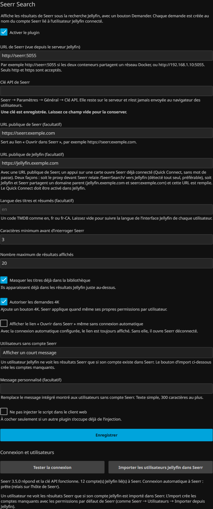

# Seerr Search

*Read in English: [README.md](README.md)*

Un plugin Jellyfin qui affiche les résultats de [Seerr](https://github.com/seerr-team/seerr) sous la
recherche du client web, avec un bouton **Demander**.

L'utilisateur cherche un film dans Jellyfin. Ce qui est déjà dans la bibliothèque s'affiche normalement;
juste en dessous, une section « Disponible sur demande » montre ce que Seerr peut aller chercher. Un clic
crée la demande **au nom du compte Seerr de cet utilisateur-là** : pas de seconde connexion, pas de mot de
passe, et les quotas, permissions et règles d'approbation de Seerr continuent de s'appliquer par utilisateur.


## Comment l'identité fonctionne

Le navigateur ne parle jamais à Seerr. Il appelle le plugin, que Jellyfin protège déjà par sa propre
authentification. Le plugin reconnaît l'utilisateur, retrouve son compte Seerr (Seerr conserve l'identifiant
Jellyfin de chaque compte importé) et relaie l'appel avec les en-têtes `X-Api-Key` et `X-Api-User`. Seerr
traite alors la demande comme si l'utilisateur l'avait faite lui-même : son quota, ses permissions, son nom
sur la demande.

**La clé API de Seerr ne quitte jamais le serveur.**

## Prérequis

- Jellyfin **12.x** (compilé et testé sur 12.2). La cible est le client web : la section s'ajoute à sa page
  de recherche. Les applications natives qui intègrent le client web l'affichent aussi; celles qui ont leur
  propre interface (Roku, Apple TV, etc.) ne sont pas touchées.
- [Seerr](https://github.com/seerr-team/seerr) joignable **depuis le serveur Jellyfin** (testé avec 3.5.0).
  Les utilisateurs Seerr doivent être des utilisateurs Jellyfin (importés depuis Jellyfin).

## Installation

1. Tableau de bord → Extensions → Dépôts → ajouter
   `https://raw.githubusercontent.com/fasterplayer/jellyfin-plugin-seerr-search/main/manifest.json`
2. Installer **Seerr Search** depuis le catalogue.
3. Redémarrer Jellyfin.
4. Tableau de bord → Extensions → Seerr Search : saisir l'URL de Seerr et la clé API, enregistrer, puis
   cliquer sur **Tester la connexion**.

Tant que l'URL et la clé ne sont pas remplies, le plugin ne fait rien : le client web n'est pas modifié et
vos utilisateurs ne voient aucun changement.

## Configuration



| Réglage | À quoi ça sert |
|---|---|
| URL de Seerr | Adresse de Seerr **vue depuis le serveur Jellyfin**, par exemple `http://seerr:5055`. `http` et `https` seulement. |
| Clé API | Seerr → Paramètres → Général → Clé API. Reste côté serveur; le formulaire ne la réaffiche jamais (laisser le champ vide pour la conserver). |
| URL publique de Seerr | Facultatif. Sert au lien « Ouvrir dans Seerr ». |
| URL publique de Jellyfin | Facultatif. Avec une URL publique de Seerr, active la connexion automatique (voir plus bas). |
| Langue | Code TMDB facultatif (`en`, `fr`, `fr-CA`…) pour les titres et résumés. **Vide = la langue de l'interface Jellyfin de chaque utilisateur.** |
| Caractères minimum / résultats maximum | Quand Seerr est interrogé et combien de cartes sont affichées. |
| Masquer les titres déjà dans la bibliothèque | Jellyfin les affiche déjà juste au-dessus. |
| Autoriser les demandes 4K | Ajoute un bouton « Demander en 4K ». Seerr applique quand même ses permissions par utilisateur. |
| Utilisateurs sans compte Seerr | Afficher un court message (par défaut, avec votre propre texte si vous voulez) ou ne rien afficher. |
| Afficher le lien « Ouvrir dans Seerr » | Même sans connexion automatique. |
| Ne pas injecter le script | Seulement si un autre plugin s'occupe de l'injection. |

### Les utilisateurs doivent exister dans Seerr

Un utilisateur Jellyfin sans compte Seerr voit un court message (ou rien, si vous l'avez choisi) et aucun
bouton. Le bouton **Importer les utilisateurs Jellyfin dans Seerr** de la page de configuration crée les
comptes manquants avec les permissions par défaut de Seerr, comme Seerr → Utilisateurs → Importer depuis
Jellyfin. **Tester la connexion** indique combien de comptes Jellyfin ne sont pas encore liés.

### Connexion automatique à Seerr (facultatif)

Un appui sur une carte peut ouvrir la fiche Seerr déjà connectée, par Quick Connect, sans mot de passe. Le
Quick Connect doit être activé dans Jellyfin et l'URL publique de Seerr remplie. Deux façons :

- **Relais (préférable, détecté tout seul).** Le proxy inverse devant Seerr relaie `/SeerrSearch/` vers
  Jellyfin. Le cookie de session est alors posé par l'hôte de Seerr lui-même, comme Seerr le ferait.
- **Domaine parent.** Jellyfin et Seerr partagent un domaine parent (`jellyfin.exemple.com`,
  `seerr.exemple.com`) et l'URL publique de Jellyfin est remplie. Le cookie est posé avec
  `Domain=exemple.com` : il est donc aussi envoyé aux autres sous-domaines. Préférez le relais si d'autres
  applications vivent sur ce domaine.

Le bouton **Tester la connexion** dit si la connexion automatique est prête et, sinon, pourquoi. Sans elle,
un appui ouvre une fiche à l'intérieur de Jellyfin (avec les boutons de demande).


## Langues

L'interface suit la langue du client web Jellyfin : **anglais** et **français** sont inclus. Les autres
langues retombent sur l'anglais. Pour en ajouter une, ajouter un bloc à `STRINGS` dans
`Jellyfin.Plugin.SeerrSearch/js/seerr-search.js` et dans `Configuration/configPage.html` : les
contributions sont les bienvenues.

## Sécurité

- La clé API reste sur le serveur : elle ne fait partie d'aucune réponse au navigateur, et le formulaire de
  configuration ne la recharge pas.
- Chaque point d'accès exige une session Jellyfin valide, sauf trois qui ne renvoient rien de privé :
  `script` (le script client, chargé par une simple balise script), `ping` (une chaîne fixe) et `sso` (il ne
  fait qu'encaisser un billet à usage unique obtenu par un utilisateur authentifié). `status` et
  `import-users` sont réservés aux administrateurs.
- L'utilisateur Seerr au nom duquel un appel agit est toujours déduit de l'utilisateur Jellyfin
  authentifié, jamais de ce qu'envoie le navigateur.
- Les URL de Seerr et publiques sont validées (`http`/`https` simples, sans identifiants ni paramètres) et
  seuls les administrateurs peuvent les saisir. L'URL de Seerr peut pointer vers votre réseau local, c'est
  voulu. Les redirections ne sont pas suivies.
- Tout ce qui vient de Seerr (titres, résumés, messages d'erreur) est affiché comme du texte, jamais comme du HTML.
- Le relais d'affiches est authentifié, parle à un hôte fixe (`image.tmdb.org`), n'accepte qu'un nom de
  fichier image simple et une taille connue, et répond toujours par un type d'image.
- Les recherches, demandes et affiches sont limitées en débit par utilisateur.
- Les billets de connexion automatique sont à usage unique, liés à l'utilisateur qui les a demandés,
  valables 90 secondes, et la cible est restreinte à un chemin Seerr simple.

Une faille ? Voir [SECURITY.md](SECURITY.md).

## Compatibilité

| Cible de compilation | Jellyfin | .NET | État |
|---|---|---|---|
| `-p:JellyfinTarget=jf12` (défaut) | 12.x | net10.0 | publiée, testée sur 12.2 |
| `-p:JellyfinTarget=jf10` | 10.11.x | net9.0 | compile en CI, **non testée, non publiée** |

Le plugin ajoute son script en réécrivant `index.html` au moment où la page est servie (un middleware
ASP.NET). Rien n'est écrit sur le disque : pas besoin d'un dossier web accessible en écriture, et une mise à
jour de `jellyfin-web` n'efface pas l'injection. Le script s'appuie sur trois éléments de la page de
recherche du client web (`#searchPage`, `#searchTextInput`, `.searchResults`) : une mise à jour majeure du
client web peut exiger une mise à jour du plugin.

## Dépannage

- **Rien n'apparaît.** Vérifiez que l'URL et la clé sont enregistrées et que **Tester la connexion** est au
  vert. Rechargez la page en vidant le cache du navigateur. La console du navigateur affiche des messages
  préfixés `[Seerr Search]`. Vérifiez que l'utilisateur a un compte Seerr.
- **La section apparaît mais la recherche échoue.** Seerr doit être joignable depuis le *serveur* Jellyfin
  (pas depuis le navigateur) : utilisez le nom du service Docker ou l'adresse du réseau local.
- **« Seerr répond, mais refuse la clé API ».** Recopiez la clé depuis Seerr → Paramètres → Général.

## Compilation

```bash
dotnet build Jellyfin.Plugin.SeerrSearch/Jellyfin.Plugin.SeerrSearch.csproj -c Release                        # Jellyfin 12
dotnet build Jellyfin.Plugin.SeerrSearch/Jellyfin.Plugin.SeerrSearch.csproj -c Release -p:JellyfinTarget=jf10 # Jellyfin 10.11
```

`tests/mock-seerr.mjs` est un petit faux Seerr (il vérifie la clé API, note l'utilisateur et la langue, et
relaie le Quick Connect à un vrai Jellyfin) qui permet d'essayer le plugin sans vrai Seerr; voir l'en-tête du
fichier.

Une version se publie en poussant une étiquette égale au numéro de version (`1.1.0.0`) : le workflow compile,
vérifie que l'étiquette, `Directory.Build.props` et `build.yaml` concordent, publie le zip et ajoute la
version (avec sa somme de contrôle) à `manifest.json`.

## Licence

GPL-3.0-only, comme le reste de l'écosystème des plugins Jellyfin (voir [LICENSE](LICENSE)). La méthode
d'injection et l'usage de `X-Api-User` s'inspirent de
[Jellyfin Enhanced](https://github.com/n00bcodr/Jellyfin-Enhanced), également sous GPLv3.
