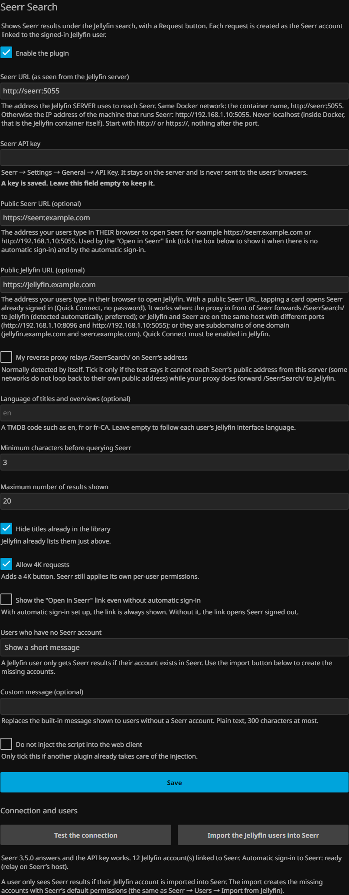

# Seerr Search

*Lire en français : [README.fr.md](README.fr.md)*

A Jellyfin plugin that shows the results of [Seerr](https://github.com/seerr-team/seerr) under the
search of the Jellyfin web client, with a **Request** button.

A user searches for a movie in Jellyfin. What is already in the library shows up as usual; right
below it, an "Available on request" section lists what Seerr can fetch. One click creates the
request, **as that user's own Seerr account**: no second sign-in, no password, and Seerr's quotas,
permissions and approval rules keep applying per user.


## How identity works

The browser never talks to Seerr. It calls the plugin, which Jellyfin already protects with its own
authentication. The plugin recognizes the user, finds their Seerr account (Seerr keeps the Jellyfin id
of every imported account) and relays the call with the `X-Api-Key` and `X-Api-User` headers. Seerr then
handles the request as if the user had made it themselves: their quota, their permissions, their name on
the request.

**The Seerr API key never leaves the server.**

## Requirements

- Jellyfin **12.x** (built and tested on 12.2). The web client is the target: the section is added to its
  search page. The native apps that embed the web client show it too; apps with their own interface (Roku,
  Apple TV, etc.) are not affected.
- [Seerr](https://github.com/seerr-team/seerr) reachable **from the Jellyfin server** (tested with 3.5.0).
  The Seerr users must be Jellyfin users (imported from Jellyfin).

## Installation

1. Dashboard → Plugins → Repositories → add
   `https://raw.githubusercontent.com/fasterplayer/jellyfin-plugin-seerr-search/main/manifest.json`
2. Install **Seerr Search** from the catalog.
3. Restart Jellyfin.
4. Dashboard → Plugins → Seerr Search: enter the Seerr URL and the API key, save, then **Test the connection**.

Until the URL and the key are filled in, the plugin does nothing: the web client is not modified and
your users see no change.

## Configuration



| Setting | Purpose |
|---|---|
| Seerr URL | Address of Seerr **as seen from the Jellyfin server**, e.g. `http://seerr:5055` (same Docker network) or `http://192.168.1.10:5055`. Never `localhost` in Docker. Only `http` and `https`, nothing after the port; a trailing `/api/v1` is dropped. |
| API key | Seerr → Settings → General → API Key. Stays on the server; the form never shows it again (leave the field empty to keep it). |
| Public Seerr URL | Optional. The address your users type **in their browser** to reach Seerr. Used by the "Open in Seerr" link and the automatic sign-in. |
| Public Jellyfin URL | Optional. The address your users type in their browser to reach Jellyfin. With a public Seerr URL, enables the automatic sign-in (see below). |
| My reverse proxy relays `/SeerrSearch/` | Optional. Normally detected by itself. Tick it only if the connection test says the server cannot reach Seerr's public address (no loop-back on your network) although your proxy does forward the path. |
| Language | Optional TMDB code (`en`, `fr`, `fr-CA`…) for titles and overviews. **Empty = each user's Jellyfin interface language.** |
| Minimum characters / maximum results | When Seerr is queried and how many cards are shown. |
| Hide titles already in the library | Jellyfin already lists them just above. |
| Allow 4K requests | Adds a "Request in 4K" button. Seerr still applies its own per-user permissions. |
| Users who have no Seerr account | Show a short message (default, optionally your own text) or show nothing. |
| Show the "Open in Seerr" link | Even without the automatic sign-in. |
| Do not inject the script | Only if another plugin takes care of the injection. |

### Users must exist in Seerr

A Jellyfin user who has no Seerr account sees a short message (or nothing, if you chose so) and no button.
The **Import the Jellyfin users into Seerr** button on the configuration page creates the missing accounts
with Seerr's default permissions, like Seerr → Users → Import from Jellyfin. **Test the connection** tells
you how many Jellyfin accounts are not linked yet.

### Automatic sign-in to Seerr (optional)

Tapping a card can open the Seerr page already signed in, through Quick Connect, with no password.
Quick Connect must be enabled in Jellyfin (it is by default), and the public Seerr URL must be filled in.
Three ways, tried in this order:

- **Relay (preferred, detected automatically).** The reverse proxy in front of Seerr forwards
  `/SeerrSearch/` to Jellyfin. The session cookie is then set by Seerr's own host, exactly as Seerr would.
- **Same host, different ports.** Jellyfin and Seerr are on the same machine and only differ by port
  (`http://192.168.1.10:8096` and `http://192.168.1.10:5055`, or `http://nas.lan:8096` and `http://nas.lan:5055`).
  Cookies ignore the port, so a plain host cookie set by Jellyfin is also sent to Seerr. This works with a bare
  IP address and needs no proxy, no domain and no TLS.
- **Parent domain.** Jellyfin and Seerr are subdomains of one domain (`jellyfin.example.com`,
  `seerr.example.com`) and the public Jellyfin URL is filled in. The cookie is set with `Domain=example.com`: it
  is therefore also sent to the other subdomains of that domain. Prefer the relay if other applications live there.

The **Test the connection** button says whether the automatic sign-in is ready, which of the three it uses, and
why not otherwise. Without it, a tap opens a detail sheet inside Jellyfin (with the request buttons): nothing is
broken, you simply stay in Jellyfin. See [Installation scenarios](#installation-scenarios) for ready-made setups.


## Installation scenarios

Search and requests only need **two** settings: the **Seerr URL** and the **API key**. The two *public* URLs are
only for the "Open in Seerr" link and the automatic sign-in, and the plugin works without them. Do not mix them up:

| Setting | Who uses it | What to put |
|---|---|---|
| Seerr URL | the Jellyfin **server**, to call Seerr | the address that works **from the machine (or container) that runs Jellyfin** |
| Public Seerr URL | the users' **browsers** | what your users type to reach Seerr |
| Public Jellyfin URL | the users' **browsers** (automatic sign-in only) | what your users type to reach Jellyfin |

### Simple LAN: IP addresses and ports, no proxy, no domain

Jellyfin on `http://192.168.1.10:8096`, Seerr on `http://192.168.1.10:5055` (same machine):

| Setting | Value |
|---|---|
| Seerr URL | `http://192.168.1.10:5055` |
| Public Seerr URL | `http://192.168.1.10:5055` |
| Public Jellyfin URL | `http://192.168.1.10:8096` |

The test then reports *Automatic sign-in to Seerr: ready (same host, different ports)*: a tap on a card opens
Seerr already signed in as that user. If your users reach Jellyfin by a name (`http://nas.lan:8096`), use that name,
for both public URLs, instead of the IP address.

Because cookies ignore ports, any other application on the same host that uses a cookie called `connect.sid` would
share it with Seerr. That is how browsers work, and it is true of Seerr itself.

**Jellyfin and Seerr on two different machines (two IP addresses)**, say Jellyfin on `http://192.168.1.10:8096` and
Seerr on `http://192.168.1.20:5055`: a browser cannot share a sign-in between two hosts, so there is no automatic
sign-in, and the detail sheet inside Jellyfin is the complete fallback (nothing is broken):

| Setting | Value |
|---|---|
| Seerr URL | `http://192.168.1.20:5055` |
| Public Seerr URL | `http://192.168.1.20:5055` |
| Public Jellyfin URL | leave empty (or fill it, it changes nothing here) |
| Show the "Open in Seerr" link even without automatic sign-in | tick it |

Tapping a card opens the sheet: **Request**, **Request in 4K** (if allowed, and if the user may in Seerr; otherwise
Seerr's own refusal is shown) and the **Open in Seerr** link to the local address (a new tab, where the user signs
in to Seerr as usual). **Test the connection** says why the automatic sign-in is off and what would turn it on.

### Docker: which Seerr URL?

`localhost` and `127.0.0.1` never work from a container: they designate the Jellyfin container itself.

- Both in the same compose file, or on a common network: use the **service/container name**, `http://seerr:5055`.
  Two separate stacks can share a network: `docker network create media`, then declare it `external: true` in both
  files (or `docker network connect media jellyfin`).
- Otherwise use the **IP address of the machine** and the *published* port: `http://192.168.1.10:5055`.
- Jellyfin in `network_mode: host`: `http://127.0.0.1:5055` works, since it is then the machine itself.

```yaml
services:
  jellyfin:
    image: jellyfin/jellyfin:12.2
    ports: ["8096:8096"]
    networks: [media]
  seerr:
    image: ghcr.io/seerr-team/seerr:latest
    ports: ["5055:5055"]
    networks: [media]
networks:
  media:
```

Seerr URL: `http://seerr:5055`. The public URLs are what the users type (`http://192.168.1.10:5055`, or your domain).

### Reverse proxy

With a proxy, give Jellyfin and Seerr a host name each (`jellyfin.example.com`, `seerr.example.com`). The plugin
needs **one** extra rule, for the automatic sign-in: on **Seerr's** host name, the path `/SeerrSearch/` goes to
**Jellyfin**. The session cookie is then set by Seerr's own host, exactly as Seerr would. The plugin detects the rule
by itself (it asks `https://seerr.example.com/SeerrSearch/ping`).

Without that rule, the two host names still work through the *parent-domain* cookie (they share `example.com`), and
without a common domain the cards simply open the detail sheet. Whatever the proxy, forward the original `Host`
header (all the files below do).

| Proxy | File to use | Tested here |
|---|---|---|
| nginx | [`docs/proxy/nginx.conf`](docs/proxy/nginx.conf) | **Yes**: http, and https (self-signed certificate) |
| Caddy 2 | [`docs/proxy/Caddyfile`](docs/proxy/Caddyfile) | **Yes**: Caddy 2.11, http, with the relay route and without it (fallback to the detail sheet) |
| Traefik v3 (Docker labels) | [`docs/proxy/traefik-labels.yml`](docs/proxy/traefik-labels.yml) | **Yes**: Traefik 3.7, http, with and without the route (the certificate-resolver lines were not exercised) |
| Nginx Proxy Manager | [`docs/proxy/npm-advanced.txt`](docs/proxy/npm-advanced.txt): the *Advanced* tab of Seerr's proxy host, or its *Custom locations* tab | **Yes**: 2.16, both ways, with and without the route (set through NPM's API with the fields of the forms; the web forms themselves were not clicked) |
| cloudflared (tunnel ingress) | [`docs/proxy/cloudflared.yml`](docs/proxy/cloudflared.yml) | **Rules only**: checked with cloudflared's own `ingress validate` / `ingress rule`; not run through a real tunnel |

The plugin settings for a proxy: Seerr URL `http://seerr:5055` (the proxy is not involved on that side), public
Seerr URL `https://seerr.example.com`, public Jellyfin URL `https://jellyfin.example.com`.

Things worth knowing:

- Put the proxy's TLS in front as usual; the plugin only sees the public URLs. The *server* talks to Seerr over the
  plain internal address, so no certificate is involved on that side. If the server must call an `https://` Seerr
  address with a self-signed certificate, it will refuse it (the test says so): use the internal `http://` address.
- If the server **cannot reach its own public address** (many home routers do not loop back), the relay cannot be
  detected: the test says *The server could not reach Seerr's public address*, and the box *My reverse proxy
  relays /SeerrSearch/* turns the feature on without detection.
- An authentication layer in front of Seerr (Authelia, Authentik, Cloudflare Access…) must let `/SeerrSearch/*`
  through on Seerr's host name, like any other path that is not Seerr's own (**not tested**).
- If Seerr's proxy sends `X-Frame-Options` or a restrictive `frame-ancestors`, Seerr opens in a new tab instead of a
  frame inside Jellyfin. This is detected and nothing needs to be done.
- Seerr's own *Settings → Network → CSRF protection* can stay on: the plugin handles it.
- Quick Connect must be on in Jellyfin (Dashboard → General; on by default), and the sign-in with Jellyfin accounts
  on in Seerr (**not tested** when it is off: the automatic sign-in then falls back to Seerr's own sign-in page).

### Jellyfin under a sub-path (`/jellyfin`)

Set *Dashboard → Networking → Base URL* to `/jellyfin` (do not strip the prefix in the proxy) and use
`https://home.example.com/jellyfin` as the public Jellyfin URL; the plugin follows the base URL by itself.
**Seerr cannot run under a sub-path** (its documentation says only sub-domains are supported): give it a host name
of its own. With a proxy, the relay rule then adds the base URL; see
[`docs/proxy/nginx-subpath.conf`](docs/proxy/nginx-subpath.conf) (**tested**, together with a direct
`http://192.168.1.10:8096/jellyfin`).

### HTTP and HTTPS, and the cookie

The automatic sign-in sets one cookie, `HttpOnly; SameSite=Lax; Path=/`, with these differences:

| Setup | `Domain` | `Secure` |
|---|---|---|
| Relay on Seerr's host | none (host cookie) | if Seerr's public URL is https |
| Same host, different ports | none (host cookie) | if both public URLs are https |
| Parent domain | the shared parent domain | if both public URLs are https |

`Secure` is never set when it would make the cookie useless: a browser drops a `Secure` cookie set over plain http,
and never sends it to a plain-http Seerr. The frame inside Jellyfin is only used on an https page, with an https
Seerr, on the same site, and when Seerr's proxy does not forbid frames; otherwise Seerr opens in a new tab.

### What was tested

Every row was run by a browser (Chromium 140 driven by Playwright) against a **new** Jellyfin 12.2.0 and a **new**
Seerr 3.5.0, with the plugin installed from a plugin repository, configured through its own page, with the
connection test, the user import, a search, a request, the "Open in Seerr" tap and a user without a Seerr account.

| Case | Setup | Result |
|---|---|---|
| A1 | LAN, one machine, IP address + two ports, no proxy, no TLS, no domain | OK, automatic sign-in works (same host) |
| A2 | LAN, Jellyfin and Seerr on two different hosts | OK: the detail sheet offers Request, Request in 4K (granted and refused by Seerr) and the "Open in Seerr" link to the local address; no error; the test explains why the sign-in is off |
| B | Wrong Seerr address: `localhost` with a wrong or right port, wrong IP port, unknown host, no `http://`, `https` on an http port, `/api/v1` suffix, a query string, Jellyfin instead of Seerr, a redirect, a 401, a page that is not Seerr, a 502, a wrong key | OK, one clear message each (English and French) |
| C | nginx, Caddy, Traefik, Nginx Proxy Manager: sub-domains of a local name, relay | OK (4 of 4) |
| C | nginx without the relay rule (parent-domain cookie); nginx with https | OK |
| C | cloudflared ingress rules | rules checked, tunnel not run |
| D | Jellyfin with base URL `/jellyfin`, direct; and behind nginx with Seerr on its own host | OK |
| D | Seerr under a sub-path | not supported by Seerr |
| E | Cookie attributes for http/https on every mode (10 combinations) and the frame on https | OK |
| Extra | Seerr with CSRF protection on; two users signing in one after the other; Seerr's proxy forbidding frames; server unable to reach its public address; update from 1.1.0.0 through the catalog | OK |

**Not tested**: Jellyfin 10.11 (the build compiles, nothing more), Jellyseerr and Overseerr, the Jellyfin mobile and TV
apps, authentication proxies in front of Seerr, a real Cloudflare tunnel, IPv6 addresses, Seerr with Jellyfin sign-in
turned off.

## Languages

The interface follows the language of the Jellyfin web client: **English** and **French** are included.
Other languages fall back to English. To add one, add a block to `STRINGS` in
`Jellyfin.Plugin.SeerrSearch/js/seerr-search.js` and in `Configuration/configPage.html`: contributions welcome.

## Security

- The API key stays on the server: it is not part of any answer to the browser, and the configuration
  form does not load it back.
- Every endpoint requires a valid Jellyfin session, except three that return nothing private:
  `script` (the client script, loaded by a plain script tag), `ping` (a fixed string) and `sso` (it only
  redeems a one-time ticket obtained by an authenticated user). `status` and `import-users` are
  administrators only.
- The Seerr user a call acts for is always derived from the authenticated Jellyfin user, never from
  anything the browser sends.
- Seerr and public URLs are validated (plain `http`/`https`, no credentials, no query) and only
  administrators can set them. The Seerr URL may point to your LAN, by design. Redirects are not followed.
- Everything coming from Seerr (titles, overviews, error messages) is shown as text, never as HTML.
- The poster relay is authenticated, talks to a fixed host (`image.tmdb.org`), accepts only a plain image
  file name and a known size, and always answers with an image type.
- Searches, requests and posters are rate limited per user.
- Automatic sign-in tickets are single use, tied to the user who asked, valid 90 seconds, and the target
  path is restricted to a plain Seerr path.

Found something? See [SECURITY.md](SECURITY.md).

## Compatibility

| Build target | Jellyfin | .NET | Status |
|---|---|---|---|
| `-p:JellyfinTarget=jf12` (default) | 12.x | net10.0 | released, tested on 12.2 |
| `-p:JellyfinTarget=jf10` | 10.11.x | net9.0 | compiles in CI, **not tested, not released** |

The plugin adds its script by rewriting `index.html` while the page is served (an ASP.NET middleware).
Nothing is written to disk, so no writable web folder is needed and a `jellyfin-web` update does not erase
the injection. The script relies on three elements of the web client's search page (`#searchPage`,
`#searchTextInput`, `.searchResults`): a major web client update may require an update of the plugin.

## Troubleshooting

- **Nothing appears.** Check that the URL and the key are saved and that **Test the connection** is green.
  Reload the page with the browser cache cleared. The browser console shows messages prefixed with
  `[Seerr Search]`. Make sure the user has a Seerr account.
- **The section appears but searching fails.** Seerr must be reachable from the Jellyfin *server* (not from
  the browser): use the Docker service name or the LAN address.
- **Test the connection says something is wrong.** The message names the address it tried:

  | Message | Meaning and fix |
  |---|---|
  | *Cannot find the host "x"* | Spelling, or the containers are not on a shared network: use the service name on a common network, or the machine's IP. |
  | *Connection refused by x:5055* | Nothing listens there: wrong port, Seerr stopped, or `localhost` inside Docker. |
  | *No answer from x (timeout)* | A firewall, or the wrong address. |
  | *The secure connection to x failed* | An `https://` address with a certificate this server does not trust, or a plain-http port. Use the internal `http://` address. |
  | *x redirects to y* | Put y in the field (often the `https://` address). |
  | *x answers 401 / 403* | A sign-in proxy or firewall sits in front of Seerr: use Seerr's direct address. |
  | *x answers 404 / is not Seerr* | Wrong port or path, or another application. |
  | *Seerr answers, but refuses the API key* | Copy the key again from Seerr → Settings → General → API Key. |

- **Automatic sign-in: "not available — …".** The test gives the reason: a public URL is missing, Quick Connect is off
  in Jellyfin, or the two addresses are on different hosts with no relay (use the same host with different ports,
  sub-domains of one domain, or the relay rule for your proxy). When the server cannot reach the public address, tick
  *My reverse proxy relays /SeerrSearch/*.
- **A tap on a card opens Seerr's sign-in page.** The one-time ticket could not be redeemed: check that the proxy
  forwards `Host`, that `/SeerrSearch/` reaches Jellyfin on Seerr's host name, and the Jellyfin log (`Seerr Search SSO`).
- **A form field was emptied after saving.** The address was not a plain `http(s)://host:port` URL: the form now says
  what to remove (user name, password, `?` or `#` parts).

## Build

```bash
dotnet build Jellyfin.Plugin.SeerrSearch/Jellyfin.Plugin.SeerrSearch.csproj -c Release                        # Jellyfin 12
dotnet build Jellyfin.Plugin.SeerrSearch/Jellyfin.Plugin.SeerrSearch.csproj -c Release -p:JellyfinTarget=jf10 # Jellyfin 10.11
```

`tests/mock-seerr.mjs` is a small fake Seerr (it checks the API key, records the acting user and the
language, and forwards Quick Connect to a real Jellyfin) that can be used to try the plugin without a real
Seerr; see the header of the file.

A release is made by pushing a tag equal to the version (`1.2.0.0`): the workflow builds, checks that the
tag, `Directory.Build.props` and `build.yaml` agree, publishes the zip and adds the version (with its
checksum) to `manifest.json`.

## License

GPL-3.0-only, like the rest of the Jellyfin plugin ecosystem (see [LICENSE](LICENSE)). The injection method
and the use of `X-Api-User` are inspired by [Jellyfin Enhanced](https://github.com/n00bcodr/Jellyfin-Enhanced),
also GPLv3.
